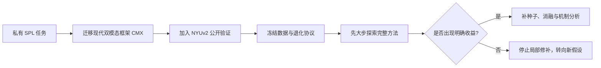
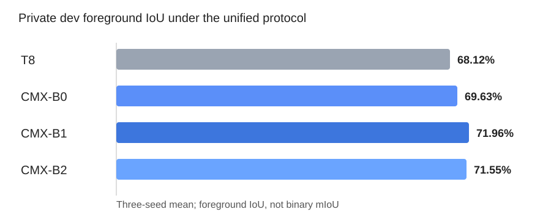
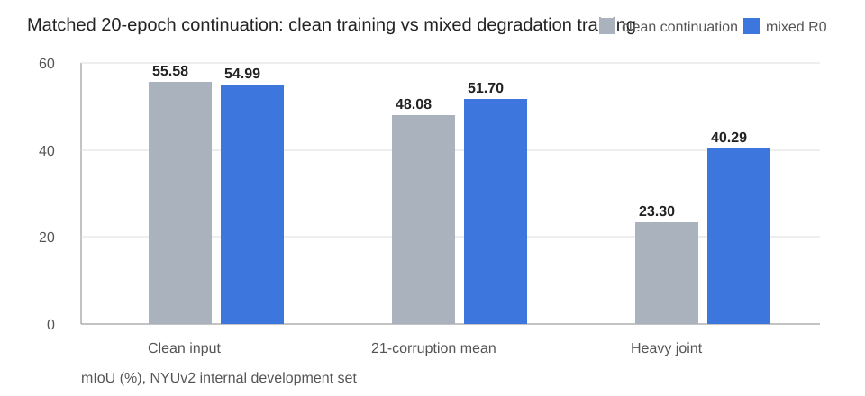
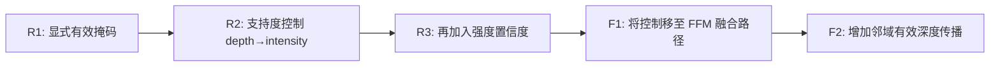
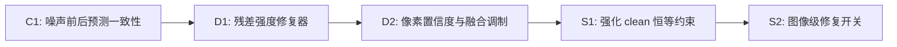

# 面向单光子 LiDAR 强度—深度数据的多模态分割研究进展

**组会汇报稿｜2026-10-09**

研究输入为单波段强度图与深度图，目标是在真实单光子 LiDAR 数据上完成稳定的目标分割，并通过公开数据验证方法的可复现性与通用性。

> 本阶段的核心变化：从“继续在旧框架上叠加局部模块”，转向“现代多模态框架＋公开验证协议＋大步探索后再缩小范围”。

文中的定性案例来自开发集，按“改善最大、退化最大、模型分歧最大”自动筛选，用于解释成功与失败模式，并非随机抽样，也不代替总体统计结果。

---

## 1. 研究思路为什么发生变化

原来的实验主要围绕 T8/UNet 类框架及门控模块展开，但逐渐暴露出三个问题：

- 私有数据无法公开，只在私有数据上获得提升，论文说服力有限；
- T8 的框架较旧，难以判断模块无效究竟来自设计本身，还是来自框架上限；
- 逐个小模块进行严格验证虽然稳妥，但探索速度慢，不容易发现真正有潜力的新方向。

因此，研究路线调整为：



**本页结论：**公开数据不再是补充实验，而是与私有数据共同决定研究方向。

---

## 2. 真实任务：私有单光子 LiDAR 数据

- 共 1390 帧，分辨率为 `128×128`；
- 输入为处理后的 intensity 与 depth，标签为背景/目标二分类；
- 目标通常较小，强度信噪比较低，深度中存在大量无效空洞；
- 当前数据不是原始光子计数或时间直方图，因此不能直接恢复严格的光子后验不确定性。


数据统一整理为：

```text
[I：归一化强度，D：有效深度归一化结果，M：深度有效掩码]
```

论文阶段冻结划分为：970 train、137 dev、283 final test。当前所有方法选择只使用 train/dev，final test 尚未访问。

---

## 3. 为什么加入 NYUv2 公开数据

私有数据负责验证真实 SPL 场景，NYUv2 负责提供可复现的公开验证环境：

- RGB 转为灰度图，作为单波段外观代理；
- 使用保留天然空洞的 `rawDepths`，不使用修复后的深度；
- 使用 NYU40 语义标签；
- 官方 795 张训练图固定划分为 715 train、80 dev；官方 654 test 暂不使用。


需要明确：灰度 NYUv2 不等于真实 SPL，人工退化也不是物理精确仿真。它的作用是构造公平、可重复的压力测试，并检验方法是否只适用于私有数据。

---

## 4. 公开数据上的退化协议

围绕任务中的两类问题，构造七类退化：

- 深度缺失：随机空洞、成片空洞、边缘空洞、低强度区域空洞；
- 数值扰动：深度噪声；
- 强度退化：泊松/高斯强度噪声代理；
- 联合退化：强度噪声＋聚集/低强度相关深度空洞。


每类退化包含轻、中、重三级：


最终评价共包含 `clean + 7类×3档 = 22` 个条件。v2 协议分别删除原本有效深度的 10%、25%、40%，避免 NYUv2 天然空洞率干扰退化强度。

---

## 5. 从 T8 到 CMX，并建立后续强基线

### 5.1 初次 CMX 迁移

先通过四组五折实验拆开“框架变化”和“输入变化”：

- `M0_T8_ILE`：T8＋强度＋局部深度边缘，前景 IoU 80.43%；
- `M1_T8_ID`：T8＋强度＋原始深度，80.68%；
- `M2_CMX_ID`：CMX-B2＋强度＋原始深度，78.23%；
- `M3_CMX_ILE`：CMX-B2＋强度＋局部深度边缘，78.00%。

直接迁移 CMX 没有超过 T8，但当时使用的是旧划分、旧预处理与旧训练协议，因此不能据此否定 CMX。

### 5.2 统一协议后的基线确认

在冻结数据协议下重新比较 T8 与不同规模的 CMX，私有开发集三种子平均结果为：



代表性案例同时说明，CMX 并非逐图都优于 T8，而是总体统计更好：


**本页结论：**统一协议下 CMX-B1 前景 IoU 为 71.96%，高于 T8 的 68.12%，因此后续采用 CMX；私有数据使用 B1，公开数据使用容量更大的 B2。

---

## 6. mixed 训练：后续模块必须超过的强基线

为避免把“见过更多退化数据”的收益误认为模块收益，首先进行了匹配的 20 轮继续训练：

- clean continuation：继续使用无人工退化数据；
- mixed R0：50% clean，另外 50% 随机抽取七类、三级退化。




mixed R0 将重度联合退化从 23.30% 提高到 40.29%，代价是 clean 下降约 0.59 个百分点。

**本页结论：**目前幅度最大的鲁棒性收益来自训练分布，而不是新模块；后续所有方法都必须与 R0 比较。

---

## 7. 方法尝试一：可靠性感知的跨模态融合

目标是：深度存在无效像素时，不让低支持度深度无条件干扰强度分支。



结果：

- R1、R2、R3 相对 R0 的 21 种退化平均变化约为 −0.007、+0.010、+0.007 pp；
- F1、F2 的平均变化约为 +0.001、+0.022 pp；
- F2 在重度联合退化上也仅提高约 0.068 pp。


**本页结论：**有效掩码、双向置信度门控和局部深度传播均未产生足够强的收益信号。

---

## 8. 诊断：模型究竟依赖哪个模态

对 R0 进行输入移除压力测试：

- clean：双模态 54.99%，强度置零 11.71%，深度置零 45.43%；
- 重度联合退化：双模态 40.29%，强度置零 3.67%，深度置零 29.88%。

这说明：

1. 当前模型主要依赖强度；
2. 深度并非无用，在噪声条件下仍提供明显补充；
3. 强度噪声可能比单独的深度空洞更值得优先处理。

输入置零属于分布外诊断，不能把下降幅度直接解释为精确的模态贡献比例。

**研究转向：**从“只根据深度空洞控制融合”转向“强度噪声适应与双模态联合鲁棒性”。

---

## 9. 方法尝试二：一致性学习与强度修复

这一方向希望做到：噪声输入需要修复，正常输入尽量保持不变，并且修复能力能够迁移到真实私有数据。



S2 相对 R0 的主要结果：

- clean：−0.407 pp；
- 21 种退化平均：+0.251 pp；
- 重度强度噪声：+1.930 pp；
- 重度联合退化：+2.565 pp。


**阶段性判断：**修复路线第一次出现了较明显的局部收益，但收益集中在强度噪声相关条件，同时损伤 clean 和其他退化条件。

---

## 10. 为什么修复路线没有直接成为主方法

进一步把“修复前端”和“分割网络”交叉组合：

```text
R0_off：原 R0 网络，关闭修复器
R0_on ：原 R0 网络，接入 S2 修复器
S2_off：S2 共同训练后的网络，关闭修复器
S2_on ：S2 共同训练后的网络，开启修复器
```

关键发现：

- 同一修复器接到原 R0 网络，重度强度噪声反而下降 2.28 pp；
- 接到共同训练过的 S2 网络，才提高 2.86 pp；
- S2 关闭前端后，clean 仍比 R0 低约 0.41 pp；
- 说明收益来自修复器与分割网络的共同适应，不是可自由插拔的通用修复器。

跨域诊断进一步发现：

- 公开数据训练的 S2 开关在私有开发集上的均值约为 0.986，几乎始终开启；
- 私有前景 IoU 从 71.06% 降至 68.57%；
- 表明公开合成退化学到的“需要修复”判据无法直接迁移到真实 SPL。

随后尝试固定教师保真 P1 与冻结分割网络 P2，仍未同时保住 clean 和退化性能，因此暂停继续修补这条路线。

---

## 11. 方法尝试三：从修复输入转向描述观测结构

新的假设是：不预先把局部区域判断成“可靠/不可靠”，也不先修复输入，而是显式提供观测结构，让网络学习如何使用。

八维描述包括：

- 当前深度是否有效；
- 3×3、7×7 邻域有效支持率；
- 强度相对 3×3、7×7 邻域均值的绝对残差；
- 深度相对 3×3、7×7 有效邻域均值的绝对残差；
- 5×5 邻域有效深度标准差。

这些量是确定性局部描述，不是已经校准的可靠性或光子后验。


四组实验：

- `B0`：原 CMX，匹配训练预算；
- `L`：普通局部卷积残差，作为额外局部处理对照；
- `E`：八维描述直接注入融合特征；
- `C`：描述与双模态特征共同产生条件权重，调制进入 FFM 的特征。

---

## 12. 观测结构实验结果

公开和私有数据从第一轮起共同参与筛选，而不是根据某一个域的成绩决定是否运行另一个域。


NYUv2 clean 代表性案例：


NYUv2 重度联合退化案例：


私有数据案例：


主要结果：

- 普通卷积 L：NYUv2 退化平均 +0.060 pp，私有前景 IoU +0.110 pp；
- 描述注入 E：分别为 +0.020 pp、+0.006 pp；
- 条件融合 C：分别为 −0.009 pp、−0.009 pp；
- 私有小区域检出均为 1/11，没有改善。

**本页结论：**E、C 没有优于普通局部卷积 L，当前观测描述的接入方式没有获得支持。

---

## 13. 从 CMX 开始到现在，实验说明了什么

### 已经得到较明确支持的结论

1. 统一协议下，CMX 比 T8 更适合作为后续多模态研究基础；
2. mixed 训练显著提高退化鲁棒性，是目前最可靠、幅度最大的正向结果；
3. 模型以强度信息为主，但深度在噪声情况下仍有补充作用；
4. 强度修复可以改善重噪声，但目前依赖网络共同适应，存在 clean 损失与跨域失配。

### 尚未得到支持的方向

1. 简单有效掩码或置信度门控；
2. 在 FRM/FFM 上增加小幅调制；
3. 把公开数据训练的强度修复器直接迁移到私有 SPL；
4. 将局部观测描述简单投影、相加或生成通道权重。

这些负结果并不证明相关信息完全无用，而是说明当前实现不足以形成论文级增益。

---

## 14. 下一步研究方向

继续遵循“先大步探索，发现信号后再缩小范围”的策略，优先尝试真正改变信息处理方式的结构：

### 方向 A：独立的多尺度观测结构分支

- 不把八维描述直接加到已有融合特征；
- 独立编码支持率、局部残差和结构变化；
- 在多个尺度上与双模态特征交互；
- 设置等参数局部卷积对照，区分结构描述与额外容量的收益。

### 方向 B：观测支持约束的信息聚合

- 让观测支持决定从哪些空间位置、哪个模态获取信息；
- 从“乘一个门控权重”升级为改变实际的信息聚合路径；
- 同时在 NYUv2 退化环境与私有 SPL 上筛选。

如果仍无清晰收益，应重新评估创新问题是否应该从“像素级可靠性”转向目标尺度、边界或跨域学习，而不是继续叠加局部门控。

---

## 15. 当前阶段总结

```text
T8旧框架
  ↓
CMX现代双模态基线
  ↓
公开数据＋冻结退化协议
  ↓
mixed强基线（明确有效）
  ↓
可靠性融合（收益极小）
  ↓
强度修复（局部有效，但有副作用和域失配）
  ↓
观测结构注入（当前接入方式无效）
  ↓
下一步：更大幅度地改变多尺度信息聚合方式
```

当前尚未形成最终论文创新模块，但已经完成了三个重要基础工作：

- 建立了可复现的公开/私有双数据验证体系；
- 建立了强基线并排除了多条弱收益路线；
- 通过细致诊断明确了强度主导、共同适应和跨域失配等关键问题。

---

## 附录：实验编号速查

- `M0–M3`：T8/CMX 与原始深度/局部深度边缘的初次迁移矩阵；
- `CMX_B0/B1/B2`：不同 MiT 骨干规模，不是自研模块；
- `R0`：mixed 退化训练的原 CMX 强基线；
- `R1–R3`：有效掩码、深度支持度与双向可靠性控制；
- `F1–F2`：FFM 路径调制与邻域深度传播；
- `C1`：噪声前后一致性；
- `D1–D2`：强度修复，以及修复＋置信度融合；
- `S1–S2`：clean 恒等约束与图像级修复开关；
- `P0–P2`：普通续训、固定教师保真、冻结分割网络；
- `B0/L/E/C`：最新观测结构实验中的基线、局部卷积、描述注入和条件融合。

> 注意：最新实验中的 `B0` 是“不加新模块的对照组”，不是骨干型号 `CMX_B0`。
