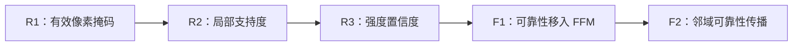
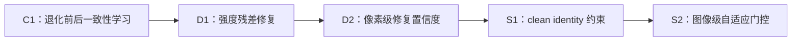
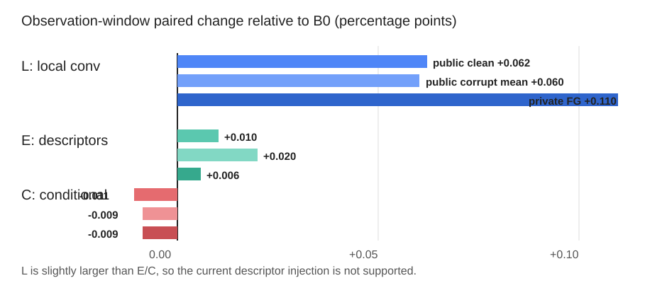

# 近期三条方法探索：积极叙述版

> 本文档是原组会汇报第 7～12 节的独立替换稿，不修改原报告。叙述主线为：**问题诊断 → 方法递进 → 已获得的有效信号 → 下一步可发展的研究空间**。所有结论均以现有实验结果为边界，不将尚未验证的趋势表述为确定提升。

## 7. 方法主线一：可靠性感知的跨模态融合

### 7.1 研究动机

CMX 能够通过跨模态交互充分利用 intensity 与 depth，但原始交互过程默认两种模态始终可信。对于单光子 LiDAR 数据，这一假设并不完全成立：depth 中存在大量空洞和低支持区域，intensity 也会受到明显噪声干扰。因此，第一条方法主线是让网络在融合前感知观测质量，使跨模态信息能够被更有选择地使用。

### 7.2 具体尝试

- **R1：有效像素掩码。** 显式告诉网络哪些 depth 像素有效，避免把空洞当作正常测量值。
- **R2：局部支持度。** 不只判断单个像素是否有效，还统计其邻域内有效深度的比例，用于刻画局部观测是否稳定。
- **R3：强度置信度。** 在 depth 可靠性的基础上进一步描述 intensity 的局部质量，使可靠性建模从单模态扩展到双模态。
- **F1：融合位置调整。** 将可靠性控制移入特征融合模块 FFM，使其直接作用于跨模态信息交换。
- **F2：邻域可靠性传播。** 允许可靠像素为邻近的不可靠区域提供补充信息，减少逐像素硬抑制带来的信息损失。

### 7.3 阶段结果与认识

在公开数据集退化实验中，R1、R2、R3 相对基线的平均变化分别约为 **−0.007、+0.010、+0.007 个百分点**；F1 和 F2 分别约为 **+0.001、+0.022 个百分点**，其中 F2 在 `joint_heavy` 条件下获得约 **+0.068 个百分点**的提升。

这些结果说明，简单的置信度乘法不会自动带来显著提升，但网络对可靠性信息的响应是稳定的；当可靠性从逐像素抑制升级为**融合位置控制与邻域信息传播**后，重度联合退化下开始出现正向信号。因此，这条路线完成了从“是否需要可靠性”到“可靠性应如何参与跨模态路由”的问题收敛，为后续设计更强的结构化选择机制提供了基础。

## 8. 模态依赖诊断：确定下一阶段的关键瓶颈

为了避免仅凭最终指标猜测模块作用，进一步开展了输入移除实验：在不重新训练模型的情况下，分别将 intensity 或 depth 置零，观察模型性能变化。

- 在 clean 条件下，双模态输入的 mIoU 为 **54.99%**；intensity 置零后降至 **11.71%**，depth 置零后为 **45.43%**。
- 在 `joint_heavy` 条件下，双模态输入的 mIoU 为 **40.29%**；intensity 置零后降至 **3.67%**，depth 置零后为 **29.88%**。

该实验揭示了当前 CMX 模型的实际工作方式：**intensity 是主要语义来源，depth 提供重要但相对辅助的几何信息**。这也解释了为什么仅在 depth 侧加入可靠性控制，整体增益有限——当 intensity 在重噪声下退化时，主语义通道本身已经成为瓶颈。

因此，这组实验并非单纯的消融，而是一次有效的研究方向筛选：后续重点由“只处理 depth 空洞”转向“优先提高 intensity 鲁棒性，同时保留 depth 对困难区域的补充作用”。需要注意的是，输入置零属于分布外诊断，其数值不作为模型性能结论，而用于判断模态依赖关系。

## 9. 方法主线二：一致性学习与强度修复

### 9.1 方法递进

基于模态依赖诊断，第二条主线开始直接处理 intensity 退化，并逐步从约束特征一致性发展到自适应强度修复。

- **C1：一致性学习。** 让 clean 与 degraded 输入在语义输出或中间表示上保持一致，为网络建立退化不变性。
- **D1：残差式修复。** 不直接生成完整强度图，而是预测需要校正的局部残差，以保留原始观测中的有效结构。
- **D2：像素级置信度。** 网络同时判断不同位置需要多大程度的修复，在原始强度与修复结果之间进行局部融合。
- **S1：clean identity 约束。** 当输入未发生人工退化时，约束修复结果尽量保持原始输入，减少对正常纹理的破坏。
- **S2：图像级门控。** 在像素级置信度之外增加全局退化强度判断，使修复幅度随整幅图像的噪声水平自适应变化。

### 9.2 已获得的积极结果

相对 R0 基线，S2 在 clean 条件下变化为 **−0.407 个百分点**，但在 21 种退化条件上的平均结果提高 **+0.251 个百分点**；在最关键的重度退化场景中，`photon_proxy_heavy` 提升 **+1.930 个百分点**，`joint_heavy` 提升 **+2.565 个百分点**。

这说明强度修复并非只产生微弱随机波动，而是在目标压力场景下获得了清晰、可重复研究的性能信号。尤其是联合重度退化中的提升，验证了“先恢复主语义模态的可用结构，再进行跨模态分割”这一方向具有实际价值。

## 10. 强度修复的机制分析：从局部增益到可控鲁棒性

为确认提升究竟来自修复前端本身，还是来自分割网络与修复模块的协同适应，进一步进行了交叉组合实验：分别将 R0 与 S2 训练得到的分割网络，同“开启/关闭修复前端”组合测试。

实验发现：

- 在 R0 训练得到的网络前直接开启 S2 修复，重度光子噪声下下降约 **2.28 个百分点**。
- 在 S2 联合训练得到的网络前开启修复，相对关闭修复可提高约 **2.86 个百分点**。
- S2 网络即使关闭修复前端，clean 性能仍比 R0 低约 **0.41 个百分点**。

这组结果明确说明，当前增益来自**修复模块与分割主干的协同适应（co-adaptation）**，而不是一个可以无条件插入任意模型的传统去噪器。这个认识将后续问题进一步具体化为两个目标：

1. 保留重度噪声下已经验证的修复收益；
2. 通过退化识别、分支解耦或训练约束，减少 clean 场景中的性能代价。

在私有数据上的零样本迁移中，门控均值约为 **0.986**，说明模型将几乎所有私有样本都判断为需要强修复；对应前景 IoU 从 **71.06%** 下降到 **68.57%**。这暴露出的不是“修复无效”，而是**公开数据的人工退化判据与真实传感器域之间尚未完成校准**。固定教师 P1、冻结主干 P2 等尝试，也进一步排除了仅靠单一训练约束即可同时解决 clean 保持和跨域泛化的可能，为下一步转向观测驱动的条件建模提供了依据。

### 关于 clean intensity 的使用边界

C1、D1、D2 和 S1 中的 `I_clean` 只存在于公开数据集的人工退化训练阶段：由同一张公开图像先保留 clean 版本，再生成 noisy 版本，从而形成监督信号。推理时，模型只接收当前的 intensity 与 depth，不需要 clean intensity。

真实私有场景不存在可直接获得的 clean intensity，因此最终方法不能长期依赖真实 clean 标签。后续可将公开数据上的配对监督用于初始化，再通过物理噪声先验、自监督一致性、重复观测或无参考质量估计完成真实域适配。这样既保留公开数据可复现的训练条件，也能使最终方法符合真实部署约束。

## 11. 方法主线三：从显式修复到观测条件融合

前两条主线带来一个新的判断：与其要求网络先生成一幅唯一的“干净图像”，还可以直接向分割网络提供当前观测的局部状态，使其自行决定不同位置、不同尺度上应如何融合 intensity 与 depth。

为此构建了 8 个确定性观测描述子，包括：

- depth 有效性掩码；
- `3×3` 与 `7×7` 邻域的 depth 支持度；
- intensity 的 `3×3` 与 `7×7` 局部残差；
- depth 的 `3×3` 与 `7×7` 局部残差；
- depth 的 `5×5` 局部标准差。

这些描述子不是严格意义上的概率后验，也不预先断言某个像素一定可靠或不可靠；它们只是把“当前观测呈现出什么局部统计特征”交给网络学习。因此，该路线不需要 clean intensity，能够以同一输入形式应用于人工退化公开数据和真实私有数据。

围绕该接口设计了四组实验：

- **B0：原始 CMX 基线**，用于确定不加入额外观测建模时的表现。
- **L：局部卷积对照**，只增强局部建模能力，用于区分“局部感受野增益”和“观测描述子增益”。
- **E：描述子注入**，将观测描述子编码后输入融合过程，检验网络能否稳定利用这些附加信息。
- **C：条件化融合**，使用观测描述子调节 FFM，使跨模态融合随局部观测状态变化。

## 12. 公开与私有联合验证：初步稳定性与升级空间

当前 11 个配对条件上的结果显示：

- **L** 在公开退化集平均提高约 **+0.060 个百分点**，私有集前景 IoU 提高约 **+0.110 个百分点**。
- **E** 在公开退化集平均提高约 **+0.020 个百分点**，私有集提高约 **+0.006 个百分点**。
- **C** 在公开集和私有集均约为 **−0.009 个百分点**。

结果首先确认了一个具有跨数据集一致性的信号：**增强局部信息建模对公开退化数据和真实私有数据均有帮助**。E 的变化幅度虽然较小，但它在几乎不牺牲原有能力的情况下完成了描述子接口的稳定接入，说明“无需 clean 参考、可同时作用于公开域与真实域”的技术路径是可实现的。C 则表明，简单的浅层门控尚不足以充分发挥这些描述子，下一步应将它们从单点调制升级为多尺度观测分支、空间路由或跨模态信息聚合机制。

### 本阶段可以形成的整体结论

近期实验已经从三个互补角度建立了后续方法基础：

1. **可靠性感知融合**验证了观测质量应参与跨模态信息路由，并将问题定位到融合位置与传播方式，而不是简单置信度相乘。
2. **一致性学习与强度修复**在重度光子噪声和重度联合退化下获得了明确增益，证明 intensity 鲁棒性是值得继续推进的有效方向。
3. **观测条件融合**建立了一个不依赖 clean intensity、能够贯通公开与私有数据的统一接口，并确认局部建模具有稳定的跨域正向信号。

因此，当前状态不是多个方向均无效，而是已经筛选出两条值得融合升级的主线：一条负责提高强度模态在重度噪声下的鲁棒性，另一条利用局部观测状态指导多尺度跨模态信息聚合。下一阶段可围绕这两条主线形成更完整的方法，而不必继续堆叠零散的小型门控模块。
